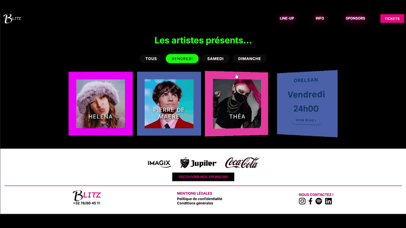
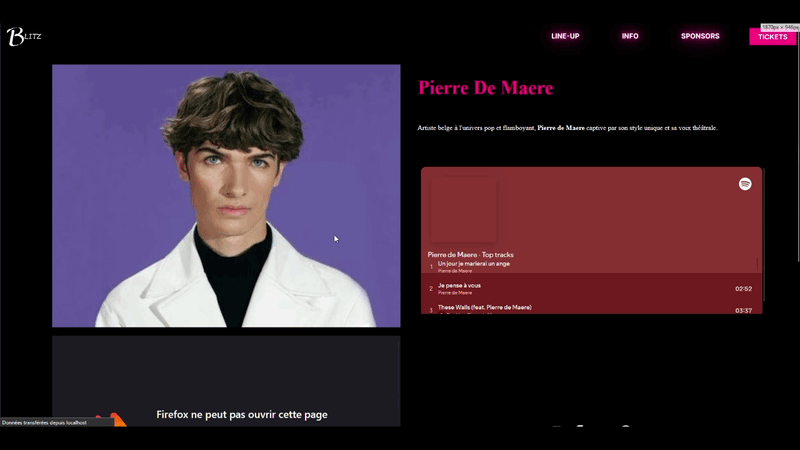

  

  

<h3 align="center">Etudiante en web developpeur, passionée par la 3D, la philo, l'économie, la musique</h3>

- 🔭 Dernier Projet : [Site Web du festival Blitz]
- Figma (https://www.figma.com/design/UcMp7jRTBB0M0LPMN5hBiK/Untitled?t=TZ4i6LJLmQHIOnD8-0)
- Site V1 (https://blitz.laurencebarthelemy.com/build/pages/lineUp.html)
- Site V2 (https://blitz3.laurencebarthelemy.com/build/pages/lineUp.php)

  
  &nbsp;
  

  
  &nbsp;&nbsp;
  
    
  

<h2>Langues</h2>
<table>
  <tr>
    <td align="center">
       
      <b>Français</b> 
      C2 (Maternelle)
    </td>
    <td align="center">
       
      <b>Anglais</b> 
      A2 (General, Commercial, IT)
    </td>
    <td align="center">
       
      <b>Néerlandais</b> 
      A2 (General, Commercial)
    </td>
    <td align="center">
       
      <b>Italien</b> 
      A1 (Autodidacte)
    </td>
  </tr>
</table>

<h2>Development WEB</h2>
<h3>Design</h3>
<table>
  <tr>
    <td></td>
    <td></td>
    <td></td>
    <td></td>
  </tr>
</table>

<h3>Frontend</h3>
<table>
 <td></td>
<td></td>
   <td></td>
    <td></td>
</table>

<h3>Backend</h3>
<table>
     <td></td>
     <td></td>
   <td></td>
</table>

<h3>Framework</h3>
<table>
  <tr>
    <td></td>
    <td></td>
    <td></td>
  </tr>
</table>
<h3>CMS</h3>
<table>
  <tr>
    <td></td>
    <td></td>
  </tr>
</table>
<h2>Hobbie/personnel</h2>
<h3>Passion 3D</h3>
<table>
  <tr>
    <td></td>
    <td></td>
    <td></td>
    <td></td>
  </tr>
</table>

<h2>Economie/Gestion</h2>
<h3>Suite Office</h3>
<table>
  <tr>
    <td></td>
    <td></td>
    <td></td>
    <td></td>
<td></td>
  </tr>
</table>

<h3>Compta</h3>
<table>
  <tr>
    <td></td>
</table>

  
  

